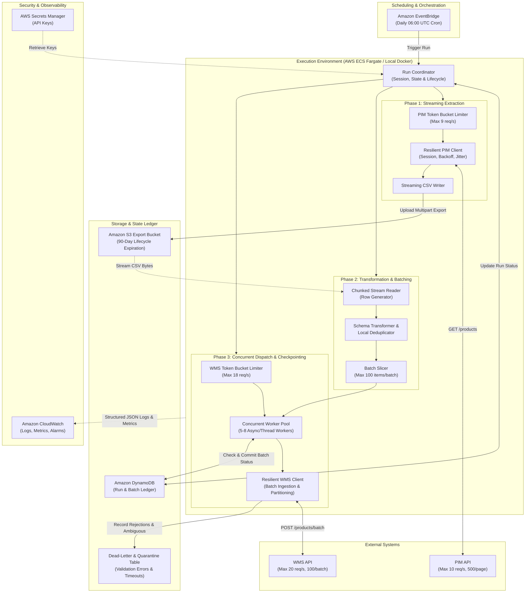
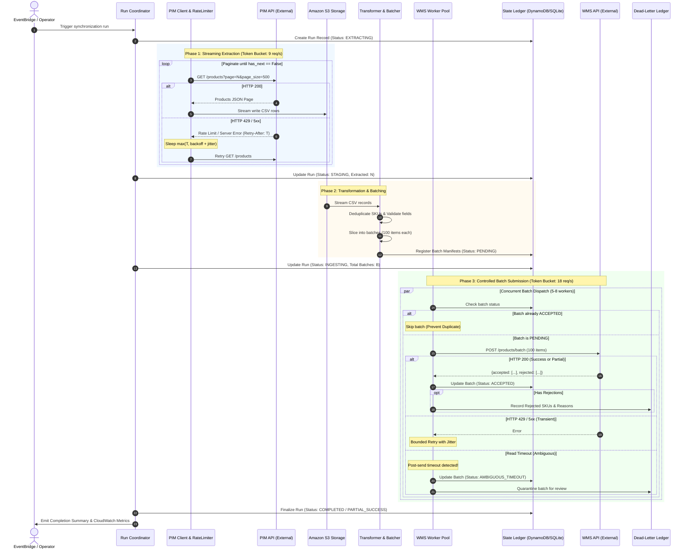
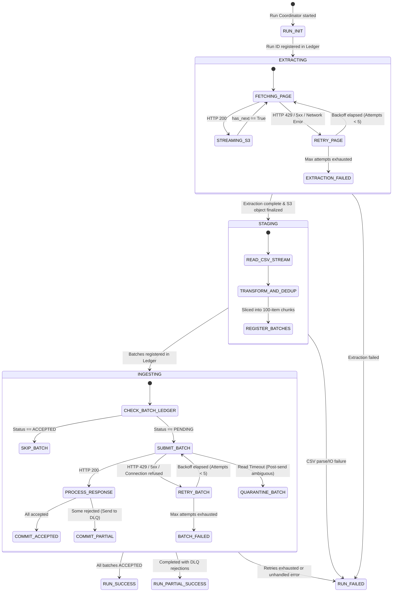
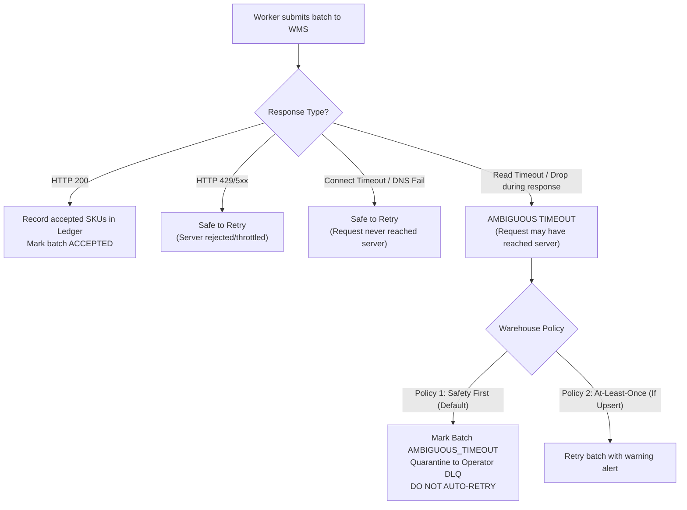
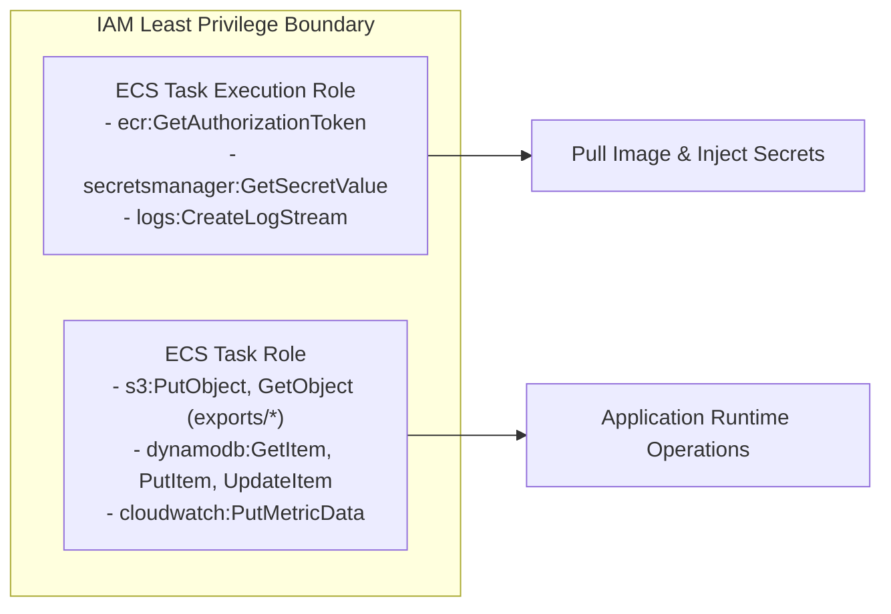
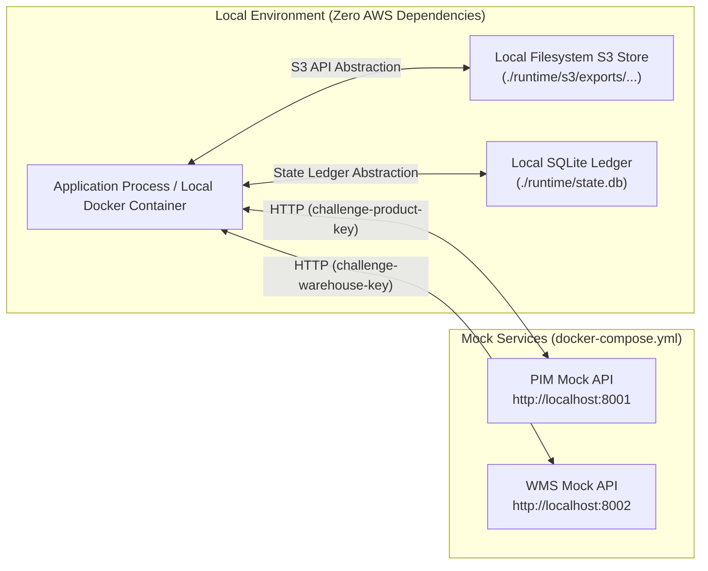

# Technical Architecture: Resilient Catalogue Synchronization (PIM to WMS)

## 1. Purpose and Scope

This document defines the production target architecture for synchronizing the product catalogue from the central Product Information Management (PIM) system to the Warehouse Management System (WMS). 

The target architecture replaces the fragile sequential script in `repository/` with an enterprise-grade, fault-tolerant, horizontally scalable, and observable integration engine designed to execute daily in AWS while remaining 100% testable in a local development environment.

---

## 2. Business Requirements and Operational Constraints

| Dimension | Requirement / Constraint | Architectural Implication |
|---|---|---|
| **Catalogue Volume** | Current: 250,000 products<br>18-Month Target: 1,000,000 products | Data processing cannot load the whole catalogue in RAM; requires streaming I/O and chunked processing. |
| **Execution Window** | Complete within **30 minutes** (1,800 seconds) | Single-threaded sequential processing will breach SLA; requires bounded concurrency and pipelining. |
| **PIM API Constraints** | Max 10 req/s, max 500 records/page, HTTP 429/5xx, variable latency (100ms–3s) | Requires client-side token bucket rate limiting (target 8.5–9.0 req/s), adaptive retry with exponential backoff and jitter. |
| **WMS API Constraints** | Max 20 req/s, max 100 records/batch, HTTP 429/5xx, partial acceptance/rejection | Requires client-side token bucket (target 17–18 req/s), batch slicing, and response partitioning into accepted and dead-letter queues. |
| **Warehouse Non-Duplication** | *"The same product must never be sent twice."* | Mandatory checkpointing of accepted batches in a durable state ledger. Ambiguous timeouts must be quarantined, not blindly retried. |
| **Data Retention** | Retain original export in Amazon S3 for **90 days** | Store timestamped export objects in S3 with automated S3 Lifecycle expiration at 90 days. |
| **Infrastructure & Ops** | AWS deployment via Terraform; local testability without AWS credentials | Containerized execution (ECS Fargate / local Docker), pluggable storage/state abstractions (S3/Local filesystem, DynamoDB/SQLite). |

---

## 3. Current-State Summary

The existing implementation executes a rigid three-step monolithic script:
1. `export_catalogue()` paginates through PIM in a single thread, collecting all records into a single in-memory Python list, and writes to a static local file (`./runtime/exports/catalogue.csv`).
2. `sync_catalogue()` reads the entire CSV into memory as a list of transformed dictionaries.
3. `send_products()` slices the list into 100-item chunks and sends them sequentially to WMS.

**Critical Deficiencies**:
- **Zero Checkpointing**: A crash at batch 2,400 of 2,500 destroys all progress.
- **Violation of Non-Duplication Rule**: Rerunning the script resends all previously accepted batches.
- **Memory Scaling Failure**: Loading 1M items into Python lists causes out-of-memory crashes on standard containers.
- **Missing S3 Integration**: `S3Store` is dead code; the export is local and overwrites previous runs.
- **No Concurrency Control or Rate Pacing**: Code fires requests in tight loops, relying on server 429 errors to slow down.
- **Silent Dropping of Rejections**: WMS HTTP 200 responses containing rejected SKUs are treated as successful.

---

## 4. Target Architecture

The target architecture utilizes an event-driven, containerized batch engine deployed on **AWS ECS Fargate**, orchestrated by **Amazon EventBridge**, with **Amazon S3** for immutable raw exports, **Amazon DynamoDB** for durable run and batch checkpointing, **AWS Secrets Manager** for secure API credentials, and **Amazon CloudWatch** for logs, metrics, and alarms.

### 4.1 Architecture Diagram



---

## 5. Component Responsibilities

### 5.1 Run Coordinator (`app.core.coordinator`)
- Generates a unique, deterministic run ID: `run_YYYYMMDD_HHMMSS_<short_uuid>`.
- Manages the execution lifecycle: `INITIALIZING` $\to$ `EXTRACTING` $\to$ `STAGING` $\to$ `INGESTING` $\to$ `COMPLETED` (or `FAILED` / `PARTIAL_SUCCESS`).
- Initializes run metadata in the state store and updates run progress metrics.
- Enforces graceful shutdown and final status reconciliation on container termination (`SIGTERM`).

### 5.2 Resilient PIM Client (`app.clients.product_api`)
- Maintains an HTTP client session with connection pooling (`httpx.Client` with HTTP keep-alive).
- Paces extraction using an in-memory **Token Bucket Rate Limiter** set to 9 req/s (safety margin under the 10 req/s limit).
- Executes bounded exponential backoff with full jitter on HTTP 429, 500, 502, 503, 504 and transient network errors (`httpx.RequestError`).
- Respects `Retry-After` headers; sleeps for $\max(\text{Retry-After}, \text{backoff})$.
- Yields page records as a generator to prevent holding the entire dataset in memory.

### 5.3 Storage Adapter (`app.storage.s3`)
- Implements a unified interface for file storage (`put_stream`, `get_stream`).
- **AWS Mode**: Uses `boto3` to perform multipart streaming uploads to `s3://<bucket>/exports/YYYY-MM-DD/catalogue_<run_id>.csv`.
- **Local Mode**: Streams directly to `./runtime/s3/exports/YYYY-MM-DD/catalogue_<run_id>.csv`.
- S3 bucket is provisioned with an automated **90-Day Lifecycle Expiration Rule**.

### 5.4 Transformer & Batch Slicer (`app.services.transformer`)
- Reads CSV streams iteratively without loading the full file into memory.
- Validates records: checks for required fields (`id`, `name`), validates numeric prices with safe parsing, and logs malformed records.
- Deduplicates product IDs within the run (guarding against page-offset boundary shifts in PIM).
- Transforms PIM fields to the WMS schema:
  - `id` $\to$ `sku`
  - `name` $\to$ `description`
  - `price` $\to$ `selling_price` (float)
  - `currency` $\to$ `currency`
  - `category` $\to$ `category_code`
  - `updated_at` $\to$ `source_updated_at`
- Slices transformed records into batches strictly constrained to $\le 100$ records (`MAX_BATCH_SIZE = 100`).

### 5.5 Concurrent WMS Batch Dispatcher (`app.services.warehouse_sync`)
- Implements a bounded worker pool (5 to 8 concurrent workers) regulated by a central token bucket (18 req/s, safely below the 20 req/s limit).
- For each batch, queries the state store:
  - If status is `ACCEPTED`: skips execution entirely (guarantees zero duplicate submission).
  - If status is `PENDING` or `FAILED_RETRYABLE`: proceeds to submit.
- On HTTP 200 response, inspects the payload:
  - SKUs in `accepted` are marked as `ACCEPTED` in the state ledger.
  - SKUs in `rejected` are written to the **Dead-Letter Ledger** with failure reasons (`sku is required`, `Invalid warehouse product`).
  - Batch status is committed as `ACCEPTED` (or `PARTIAL_ACCEPTED`).

### 5.6 Durable State & Checkpoint Store (`app.storage.state`)
- **AWS Mode**: Uses Amazon DynamoDB with two tables:
  1. `CatalogueSyncRuns`: Partition key `run_id`. Stores overall progress, total products, accepted count, rejected count, start and end timestamps.
  2. `CatalogueSyncBatches`: Partition key `run_id`, Sort key `batch_id`. Stores batch status (`PENDING`, `ACCEPTED`, `PARTIAL_ACCEPTED`, `FAILED_RETRYABLE`, `AMBIGUOUS_TIMEOUT`), attempt count, and payload hash.
- **Local Mode**: Uses SQLite (`./runtime/state.db`) with an identical relational schema, enabling 100% offline testing without AWS credentials.

---

## 6. End-to-End Execution and Data Flow



---

## 7. State Model and Recovery Strategy

### 7.1 State Transition Diagram



### 7.2 Crash Recovery Scenarios

| Crash Point | Residual State | Recovery Procedure on Rerun |
|---|---|---|
| **Crash during PIM Extraction** | Partial CSV file in S3 / local storage. Run status is `EXTRACTING`. | The coordinator detects the incomplete run. Rerunning with the same run ID can resume from the last successful page number, or starting a new run generates a fresh run ID and re-extracts the catalogue cleanly. |
| **Crash during Batch Ingestion (e.g. at batch 1,200 of 2,500)** | Batches 1–1,199 are marked `ACCEPTED` in DynamoDB/SQLite. Batches 1,200–2,500 are `PENDING`. | Operator or scheduler triggers recovery for the `run_id`. The dispatcher loads all batches, inspects the ledger, **skips batches 1–1,199 immediately**, and processes only batches 1,200–2,500. Zero duplicate calls are made to WMS. |
| **Worker Container Abrupt Kill (SIGKILL / OOM)** | Some batches left in `IN_FLIGHT` or `PENDING`. | Batches in `IN_FLIGHT` that exceeded a visibility timeout ($\approx 2\text{ minutes}$) automatically revert to `PENDING` for redelivery, while `ACCEPTED` batches remain permanently protected. |

---

## 8. Retry, Backoff, and Rate-Limiting Policies

### 8.1 Rate Limiting: Token Bucket Algorithm
To enforce strict compliance with external API limits without depending on distributed lock managers:
- **PIM Extraction Token Bucket**:
  - Capacity: 10 tokens. Refill rate: 9.0 tokens/second (10% safety margin below 10 req/s limit).
  - Workers must acquire a token before issuing `GET /products`.
- **WMS Ingestion Token Bucket**:
  - Capacity: 20 tokens. Refill rate: 17.5 tokens/second (12.5% safety margin below 20 req/s limit).
  - Workers must acquire a token before issuing `POST /products/batch`.

### 8.2 Retry Policy with Full Jitter
To prevent synchronization storms and thundering herd behavior against degraded mock services:
$$\text{Sleep} = \min\left(T_{\max},\; \text{Uniform}(0,\; T_{\text{base}} \times 2^{\text{attempt}})\right)$$
- $T_{\text{base}} = 0.5\text{ seconds}$
- $T_{\max} = 8.0\text{ seconds}$
- $\text{Max Attempts} = 5$
- **Header Precedence**: If response contains `Retry-After: N`, then:
  $$\text{Sleep} = \max(N,\; \text{calculated backoff})$$
- **Transient vs Permanent Error Classification**:
  - **Transient (Retryable)**: HTTP 429 (Rate Limit), HTTP 500 (Internal Error), HTTP 502 (Bad Gateway), HTTP 503 (Service Unavailable), HTTP 504 (Gateway Timeout), TCP connection timeouts, socket resets.
  - **Permanent (Non-Retryable)**: HTTP 400 (Bad Request), HTTP 401 (Invalid API Key), HTTP 403 (Forbidden), HTTP 404 (Not Found), HTTP 413 (Payload Too Large). Permanent errors immediately fail the batch/step without retrying.

---

## 9. Partial Success and Dead-Letter Handling

The mock WMS endpoint validates SKUs individually and returns HTTP 200 with partitioned arrays:
```json
{
  "accepted": ["P0000001", "P0000002"],
  "rejected": [
    {"sku": "P0000999", "reason": "Invalid warehouse product"},
    {"sku": null, "reason": "sku is required"}
  ],
  "message": "Processed"
}
```

### 9.1 Dead-Letter Ledger Strategy
1. The client parses both `accepted` and `rejected` lists.
2. The batch is committed to the state store as `PARTIAL_ACCEPTED`.
3. Every rejected item is recorded in the `DeadLetterRecords` table (or local DLQ file) with:
   - `run_id`, `batch_id`, `sku`, `reason`, `timestamp`, and the original product payload.
4. An operational metric `ProductsRejected` is incremented in CloudWatch.
5. If the rejection rate exceeds a configurable threshold (e.g., $>5\%$ of total catalogue), a CloudWatch Alarm triggers an alert to operations.
6. A run with rejections completes with status `COMPLETED_WITH_REJECTIONS` rather than `SUCCESS`, alerting operators to inspect the DLQ.

---

## 10. Duplicate Prevention and Ambiguous Outcomes

### 10.1 The Reality of the Two Generals Problem
The Warehouse team stated: *"The same product must never be sent twice."*
However, direct code inspection of the mock WMS API (`mock-services/warehouse-api/app/main.py`) reveals:
1. No `Idempotency-Key` or request-ID header is supported.
2. No query endpoint exists (e.g., `GET /products/{sku}`) to check if a SKU has already been recorded.
3. The WMS accepts duplicate submissions of the same SKU across requests without error.

**Fundamental Distributed Systems Constraint**:
If a network disconnect, TCP reset, or read timeout occurs **after** the client has transmitted the request body to the WMS, the client cannot know whether:
- **Case A**: The WMS processed the request and updated the database, but the response was lost in transit.
- **Case B**: The connection dropped before the WMS read the request body, and nothing was processed.

Without server-side idempotency or a query endpoint, **strictly exactly-once delivery across an unreliable network is mathematically impossible**. Claiming otherwise is technically dishonest.

### 10.2 Practical Mitigation Architecture
To provide the strongest possible guarantee supported by the actual systems:



1. **Client-Side Deduplication**: The transformer eliminates duplicate SKUs within the source catalogue before batching.
2. **Durable State Checkpointing**: Successful batches are committed immediately. Reruns and retries **never** resubmit batches marked `ACCEPTED`.
3. **Ambiguous Outcome Isolation**:
   - Connection failures occurring **before** request transmission (e.g. connection refused, DNS timeout) are classified as `PRE_SEND_FAILURE` and are safely retried.
   - Timeouts occurring **after** request transmission begins (e.g. `httpx.ReadTimeout`) are classified as `AMBIGUOUS_TIMEOUT`.
   - By default, ambiguous batches are **quarantined** in the Dead-Letter Ledger and flagged for operator review rather than blindly retried, strictly honoring the mandate not to risk duplicate delivery.
4. **Upstream Recommendation**: Provide a formal recommendation to the Warehouse engineering team to implement an `Idempotency-Key` HTTP header (or upsert semantics on SKU) to enable 100% automated retry safety.

---

## 11. AWS Service Selection and Trade-Off Analysis

| AWS Service | Selected? | Role in Target Architecture | Rationale & Trade-offs |
|---|---|---|---|
| **Amazon EventBridge** | **Yes** | Daily Scheduled Trigger | Native cron scheduling (`cron(0 6 * * ? *)`), fully managed, zero maintenance, integrates directly with ECS RunTask. |
| **AWS ECS Fargate** | **Yes** | Batch Execution Engine | **Chosen over Lambda**. A 1M product sync takes 10–14 minutes. Lambda has a hard 15-minute execution limit. Fargate allows long-running execution, containerized dependencies, centralized token-bucket rate limiting without distributed redis/dynamodb locks, and high-performance streaming I/O. |
| **Amazon S3** | **Yes** | Raw Export Storage & Retention | Native storage for immutable CSV/Parquet catalogue files. Lifecycle configuration enforces the mandatory **90-day retention rule** at minimal cost. |
| **Amazon DynamoDB** | **Yes** | Run & Batch State Ledger | Serverless, single-digit millisecond latency, pay-per-request pricing. Enables durable checkpointing without operating relational databases. Replaced by SQLite during local testing. |
| **AWS Secrets Manager** | **Yes** | Secure API Key Storage | Securely manages `PRODUCT_API_KEY` and `WAREHOUSE_API_KEY` with automated rotation support. Passed to ECS task via IAM execution role. |
| **Amazon CloudWatch** | **Yes** | Logs, Metrics & Alarms | Centralized structured JSON logging, execution duration metrics, rate-limit throttling counts, and failure alerting. |
| **AWS Step Functions** | *Alternative (P2)* | Multi-Task Orchestration | Evaluated for orchestrating multi-container pipelines. Omitted from initial P0/P1 scope to avoid over-engineering during the 48-hour window, as the single ECS task handles internal phase coordination cleanly. |
| **Amazon SQS** | *Alternative (P2)* | Distributed Work Distribution | Evaluated for distributing batches across multiple worker Lambdas. Omitted because distributing work across multiple independent workers makes global rate limiting (max 20 req/s) exceedingly difficult and costly without centralized token buckets. |

---

## 12. Security and IAM Architecture



### 12.1 Security Controls
1. **Secrets Management**: No plaintext API keys in code or environment variables. Production ECS task definition references Secrets Manager ARNs:
   - `PRODUCT_API_KEY`: `arn:aws:secretsmanager:...:secret:catalogue/product_api_key`
   - `WAREHOUSE_API_KEY`: `arn:aws:secretsmanager:...:secret:catalogue/warehouse_api_key`
2. **Least Privilege IAM**:
   - `TaskRole` granted `s3:PutObject` and `s3:GetObject` only on the specific catalogue bucket ARN (`arn:aws:s3:::company-catalogue-sync-*`).
   - DynamoDB access restricted to `CatalogueSyncRuns` and `CatalogueSyncBatches` tables.
3. **Data Protection at Rest and in Transit**:
   - S3 bucket encrypted with AWS KMS (`aws:kms`) or AES-256 (`AES256`).
   - S3 bucket enforces TLS (`aws:SecureTransport: true`).
   - DynamoDB encrypted at rest with AWS-managed keys.
   - All HTTP communication with external APIs enforces TLS 1.2+.

---

## 13. Observability and Operational Run Status

### 13.1 Operational Run Status
Operators can inspect the status of any run via CLI, CloudWatch, or DynamoDB:
- `PENDING`: Run created, waiting to start.
- `EXTRACTING`: Fetching pages from PIM and streaming to S3.
- `STAGING`: Validating and batching CSV records.
- `INGESTING`: Submitting batches to WMS.
- `COMPLETED`: 100% of products accepted by WMS.
- `COMPLETED_WITH_REJECTIONS`: Synchronization finished, but some products were rejected by WMS for business validation reasons (inspect DLQ).
- `FAILED`: Unrecoverable exception or retries exhausted.

### 13.2 Structured Logging Format
All application events emit single-line structured JSON logs with correlation metadata:
```json
{
  "timestamp": "2026-10-14T18:30:00.123Z",
  "level": "INFO",
  "run_id": "run_20261014_060000_a1b2c3",
  "component": "warehouse_sync",
  "event": "batch_submitted",
  "batch_id": "batch_00042",
  "batch_size": 100,
  "accepted_count": 99,
  "rejected_count": 1,
  "duration_ms": 284,
  "http_status": 200
}
```

### 13.3 CloudWatch Custom Metrics
- `PimExtractDurationSeconds` (Gauge)
- `PimRequestThrottles` (Counter, HTTP 429)
- `WmsSubmitDurationSeconds` (Gauge)
- `WmsBatchesSubmitted` (Counter)
- `WmsProductsAccepted` (Counter)
- `WmsProductsRejected` (Counter)
- `WmsAmbiguousTimeouts` (Counter)

---

## 14. Scalability and 30-Minute Throughput Assessment

### 14.1 Mathematical Model of Synchronization Runtime

Let:
- $N$ = Catalogue size (250,000 or 1,000,000)
- $S_{\text{PIM}}$ = PIM page size (500)
- $S_{\text{WMS}}$ = WMS batch size (100)
- $R_{\text{PIM}}$ = PIM request rate (target 8.5 req/s, limit 10 req/s)
- $R_{\text{WMS}}$ = WMS request rate (target 17.0 req/s, limit 20 req/s)
- $L_{\text{PIM}}$ = PIM average request latency (assumed $\approx 400\text{ ms}$)
- $L_{\text{WMS}}$ = WMS average batch latency (assumed $\approx 300\text{ ms}$)
- $W_{\text{WMS}}$ = Number of concurrent WMS workers in pool ($W \ge R_{\text{WMS}} \times L_{\text{WMS}} = 17 \times 0.3 \approx 5.1 \implies \mathbf{6\text{ workers}}$)

#### Total Request Volumes:
- **At 250,000 products**:
  - PIM Requests: $250,000 / 500 = 500$ requests.
  - WMS Batches: $250,000 / 100 = 2,500$ batches.
- **At 1,000,000 products**:
  - PIM Requests: $1,000,000 / 500 = 2,000$ requests.
  - WMS Batches: $1,000,000 / 100 = 10,000$ batches.

#### Phase Durations under Pipelined Execution:

| Execution Phase | Current Scale (250,000) | Projected Scale (1,000,000) | Calculation Method |
|---|---|---|---|
| **PIM Extraction** | $\approx 59\text{ seconds}$ ($\approx 1.0\text{ min}$) | $\approx 235\text{ seconds}$ ($\approx 3.9\text{ min}$) | $N_{\text{req}} / 8.5\text{ req/s}$ |
| **Transformation / Batching** | $\approx 10\text{ seconds}$ | $\approx 40\text{ seconds}$ | Streaming in-memory generator |
| **WMS Batch Ingestion** | $\approx 147\text{ seconds}$ ($\approx 2.5\text{ min}$) | $\approx 588\text{ seconds}$ ($\approx 9.8\text{ min}$) | $N_{\text{batch}} / 17.0\text{ req/s}$ (with 6 workers) |
| **Estimated Retries / Tail Latency** | $\approx 30\text{ seconds}$ | $\approx 90\text{ seconds}$ | 5% mock transient error overhead |
| **Total Staged Duration** | $\approx \mathbf{4.1\text{ minutes}}$ | $\approx \mathbf{15.9\text{ minutes}}$ | Sum of extraction + ingestion |
| **Total Pipelined Duration** | $\approx \mathbf{2.8\text{ minutes}}$ | $\approx \mathbf{10.5\text{ minutes}}$ | Overlapped extraction & ingestion |

### 14.2 Conclusion on the 30-Minute SLA
The 30-minute requirement is **comfortably achievable** for both the 250,000 and 1,000,000 catalogue sizes, provided:
1. Extraction and ingestion utilize token-bucket rate pacing rather than single-threaded blocking requests.
2. WMS dispatching employs a concurrent worker pool ($5 - 8$ workers) to saturate the 17 req/s throughput against typical 300ms server response times.
3. Total projected runtime for 1,000,000 products is **$\approx 16\text{ minutes}$ in staged mode** and **$\approx 11\text{ minutes}$ in streaming pipelined mode**, leaving a $>14\text{ minute}$ safety buffer for network degradation, retries, and backoff.

---

## 15. Local Execution and Testing Architecture

To satisfy the strict constraint that the system must be testable locally without AWS credentials or cloud deployments:



- **Pluggable Storage Abstraction**: When `AWS_EXECUTION_ENV` is absent or `STORAGE_BACKEND=local`, the storage layer redirects S3 operations to the local filesystem (`./runtime/s3`).
- **Pluggable State Abstraction**: When `STATE_BACKEND=sqlite`, DynamoDB calls route to a local SQLite database (`./runtime/state.db`) with an identical relational schema.
- **Standard Docker Compose**: Uses the existing `docker-compose.yml` to spin up `mock-services/product-api` on port 8001 and `mock-services/warehouse-api` on port 8002.
- **Offline CLI Support**: The sync engine can be triggered via standard Python:
  ```bash
  python -m app.main --mode=local --run-id=test_run_01
  ```

---

## 16. Terraform Deployment Layout

The infrastructure is organized into clean, reusable Terraform modules under `terraform/`:

```text
terraform/
├── main.tf                  # Provider configuration and module wiring
├── variables.tf             # Input variables (environment, catalogue size, rates)
├── outputs.tf               # Output ARNs (S3 bucket, ECS task, CloudWatch dashboard)
├── terraform.tfvars.example # Example configuration
└── modules/
    ├── s3/                  # S3 export bucket with 90-day lifecycle rule
    ├── dynamodb/            # DynamoDB tables for runs, batches, and dead-letters
    ├── ecs/                 # ECS Cluster, Task Definition (Fargate), and Log Group
    ├── eventbridge/         # Scheduled rule and IAM invocation targets
    ├── secrets/             # Secrets Manager resources for API keys
    └── iam/                 # Least-privilege IAM roles and policies
```

### Key Terraform Configurations:
1. **S3 90-Day Retention**:
   ```hcl
   resource "aws_s3_bucket_lifecycle_configuration" "export_retention" {
     bucket = aws_s3_bucket.catalogue_exports.id
     rule {
       id     = "expire-exports-after-90-days"
       status = "Enabled"
       expiration {
         days = 90
       }
     }
   }
   ```
2. **ECS Fargate Task Sizing**:
   - CPU: 1024 (1 vCPU)
   - Memory: 2048 (2 GB RAM)
   - Cost: Runs for $\approx 15\text{ minutes/day} \implies < \$0.50/\text{month}$.

---

## 17. Key Architectural Trade-Offs and Decisions

| Decision Area | Selected Approach | Alternative Considered | Justification & Trade-Offs |
|---|---|---|---|
| **Compute Engine** | ECS Fargate Scheduled Task | AWS Lambda | Lambda has a hard 15-minute execution limit, risking mid-flight timeouts as the catalogue grows to 1M items. ECS Fargate provides unbounded execution, in-memory rate limiting, and zero server management at comparable cost. |
| **Work Distribution** | In-Process Concurrent Pool | SQS + Distributed Lambda Workers | Distributed rate limiting across dozens of Lambdas to enforce a 20 req/s warehouse cap is notoriously difficult and prone to thundering herds. In-process token buckets within Fargate provide microsecond-accurate rate limiting with far lower operational complexity. |
| **State Storage** | DynamoDB (Prod) / SQLite (Local) | Amazon RDS (PostgreSQL) | DynamoDB provides serverless, on-demand pricing, single-digit millisecond key-value lookups, and zero maintenance. Running an RDS instance for a once-daily 15-minute job is cost-inefficient. |
| **Export File Format** | CSV with RFC 4180 compliance | Apache Parquet / JSON Lines | The business requirement specifically mandates CSV export for warehouse auditing. CSV provides high human readability and low parse overhead. Parquet is recommended as a future enhancement for analytical queries. |
| **Ambiguous Timeouts** | Quarantine to DLQ (No auto-retry) | Blind Exponential Retry | Without WMS idempotency keys or lookup endpoints, retrying post-send timeouts risks violating the warehouse mandate: *"The same product must never be sent twice."* Quarantining protects data integrity. |

---

## 18. Assumptions and Unresolved Questions

### Validated Facts from Code Inspection:
1. PIM API enforces offset pagination (`page`, `page_size`, max 500) and returns 429 and 503 intermittently.
2. WMS API enforces a maximum batch size of 100, rejects SKUs ending in `999` or empty SKUs, and returns 429 and 503 intermittently.
3. WMS API has **no** idempotency key support and **no** query endpoint to verify existing SKUs.

### Working Assumptions:
1. **Source Stability**: PIM catalogue records are assumed to remain reasonably stable during the daily 4-minute extraction window.
2. **Warehouse Tolerance for Quarantined Batches**: The warehouse team prefers having ambiguous batches held in a quarantine queue for automated/manual reconciliation rather than receiving duplicate physical records.
3. **Execution Trigger**: The sync runs once daily (scheduled at off-peak hours, e.g., 06:00 UTC), but can be invoked manually on-demand for recovery.

### Unresolved Upstream Questions:
1. Can the WMS team add an `Idempotency-Key` HTTP header (or an idempotent upsert on `sku`) to eliminate the Two Generals ambiguity?
2. Does the PIM API support timestamp-based delta extraction (e.g. `updated_since=...`) to enable incremental synchronization rather than full catalogue dumps?
